<div align="center">

  <!-- Animated Cyberpunk HUD Banner -->
  

  <br />

  <!-- Animated Terminal Typing Stream -->
  <a href="https://github.com/kristofer-steven">
    
  </a>

  <!-- Cyberpunk Social Uplinks -->
  <p align="center">
    <a href="https://linkedin.com/in/kristofer-steven">
      
    </a>
    <a href="mailto:kristofersteven0@gmail.com">
      
    </a>
  </p>

</div>


### ⚡ About Me

```yaml
operator: "Kristofer Steven"
role: "Full-Stack Engineer & AI/ML Enthusiast"
mission: "Bridging scalable web architecture with applied Artificial Intelligence"
```

- 🔭 **Focus:** Full-Stack Web Engineering & Applied AI/ML Systems
- 🧠 **Exploring:** LLM Agents, RAG Pipelines, Deep Learning & Scalable Microservices
- 🤝 **Open to:** Collaborating on AI-native products and open-source projects


### 🛠️ Tech Stack

#### 🧠 AI & Machine Learning
<p>
  
  
  
  
  
  
  
  
  
</p>

#### 💠 Frontend Development
<p>
  
  
  
  
  
  
  
</p>

#### ⚙️ Backend, Databases & Infrastructure
<p>
  
  
  
  
  
  
  
  
  
  
</p>


### 📊 GitHub Analytics

<div align="center">
  
  
</div>

<div align="center">
  
</div>


### 🐍 Contribution Matrix

<div align="center">
  
</div>
